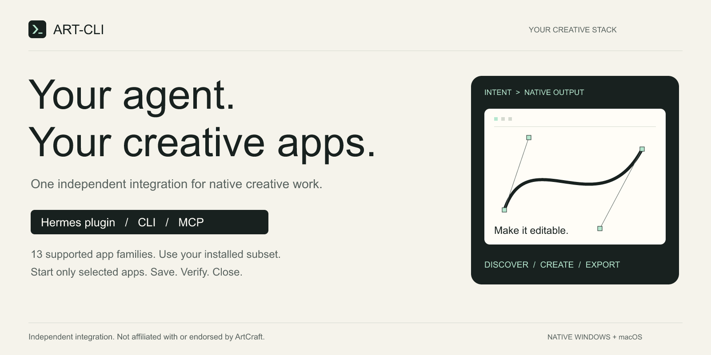
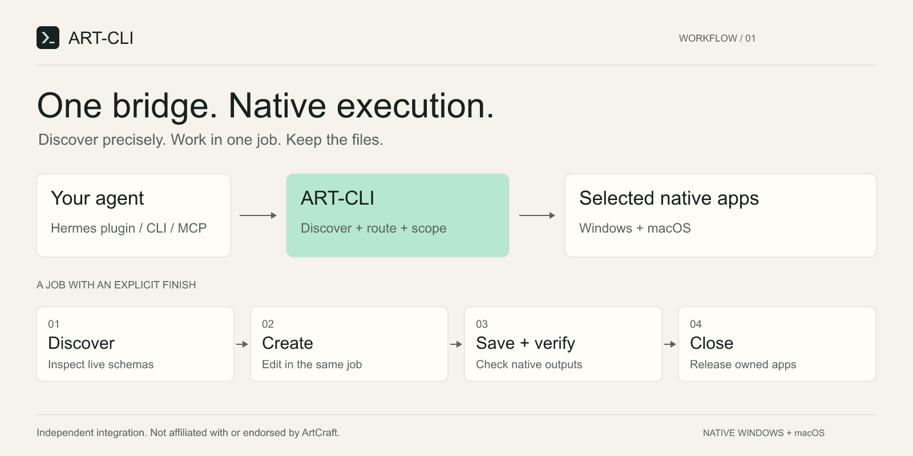

# ART-CLI

**Eine Anbindung für 13 ArtCraft-App-Familien – als Hermes-Plugin, CLI oder stdio-MCP.** Native Projekte erstellen, bearbeiten, speichern und exportieren. Für Windows und macOS, ohne dreizehn dauerhaft laufende App-Server.

[Download](https://github.com/kosecom/art-cli/releases/latest) · [English](README.md) · [Einrichtung](docs/SETUP.md) · [Technische Referenz](docs/CLI.md)

## Gib das Paket deinem Agenten

ZIP herunterladen und entpacken. Dann:

> Lies START-HERE.md. Prüfe dieses Paket und meine ArtCraft-CLIs. Installiere die Anbindung in das von mir gewählte Profil. Verwende das Hermes-Plugin oder alternativ MCP/CLI. Lade ohne Freigabe nichts herunter und ändere keine App-Berechtigungen. Prüfe anschließend, welche Apps einsatzbereit sind.

```text
python setup_art.py --home "<absolutes-Ziel-Home>" --agent hermes --check
python setup_art.py --home "<absolutes-Ziel-Home>" --agent hermes --install
```

Unter macOS heißt Python häufig `python3`. Für Hermes dessen Python-Umgebung verwenden. Aktivierung entsprechend dem Setup-Bericht vornehmen und eine neue Sitzung starten. `--agent mcp` liefert eine MCP-Konfiguration, `--agent cli` die direkten Aufrufe.

**Wichtig:** Eine installierte GUI-App garantiert nicht die benötigte native CLI. Insbesondere auf Mac können separate offizielle CLI-Dateien nötig sein. Fehlende Apps werden gemeldet; es genügt auch eine Teilmenge der 13 Apps. Kein stiller Download, keine Änderung des globalen PATH und kein Gateway-Neustart.

## Damit kannst du arbeiten

- **Grafik und Fotos:** VectorCraft, PhotoCraft, LightCraft, FigCraft.
- **Dokumente und Layout:** DesignCraft, WordCraft, PdfCraft.
- **Präsentationen und Tabellen:** DeckCraft, GridCraft.
- **Video, Motion und Audio:** FilmCraft, EffectCraft, SoundCraft.
- **Technische Zeichnungen:** CADCraft.



Beispiel: „Erstelle ein Test-Logo in VectorCraft, speichere ein editierbares Projekt und exportiere SVG und PNG. Öffne die Datei erneut und prüfe das Ergebnis.“

**Hintergrund-Engine ist nicht die sichtbare Oberfläche.** Ein natives Projekt wird nicht automatisch im gerade geöffneten Fenster oder unter „Letzte Projekte“ angezeigt. Dafür die gespeicherte Datei öffnen. GUI-Steuerung und Remote-Routing sind separate Einrichtungen.

## Nachweise statt Vollständigkeitsversprechen

Native Windows-/Mac-Tests decken Integration, Prozessverwaltung, Abbrüche, Protokollfehler, Installer und Remote-Lesezugriffe ab. Ein geprüfter Versionsstand hatte je Host 728 Tool-Schemas und 6.704 Editor-Einträge. **Das ist keine Behauptung, jede Funktion ausgeführt zu haben.** Formate und Funktionen hängen von den installierten App-Versionen ab.

[Prüfumfang](docs/ACCEPTANCE.md) · [Sicherheit](SECURITY.md) · [Änderungen](CHANGELOG.md)

Unabhängige kosecom-Integration, keine offizielle ArtCraft-/Hermes-Veröffentlichung. MIT-Lizenz für unseren Integrationscode; Anwendungen und Drittanbieter-Assets bleiben separat lizenziert. Die Erklärungsgrafiken wurden über ART-CLI mit der nativen VectorCraft-Engine erstellt.
