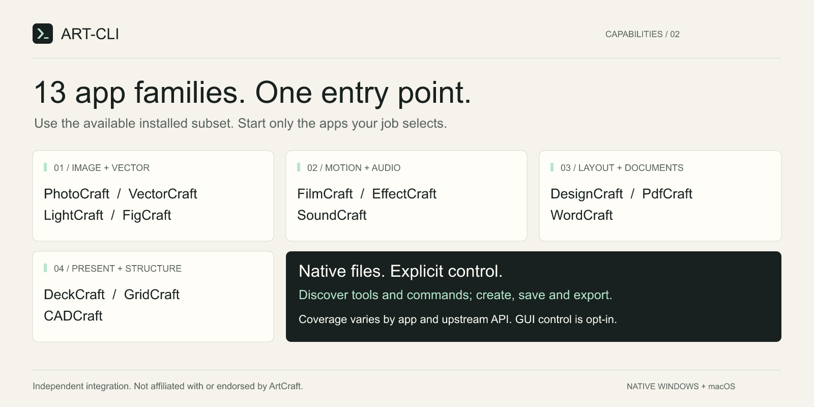

<p align="center"></p>

<p align="center">
<a href="https://github.com/kosecom/art-cli/releases/latest"></a>
<a href="LICENSE"></a>


</p>

# ART-CLI

### Your agent. Your creative apps.

**One on-demand bridge between AI agents and 13 ArtCraft application families.** Create and edit real documents, discover native capabilities, save editable projects and export deliverables — through a native **Hermes plugin**, a **CLI**, or a **stdio MCP server**.

Built by **kosecom**. Independent integration; not an official ArtCraft or Hermes product. Applications and their licenses are separate. [Third-party notice →](NOTICE.md)

**[Download](https://github.com/kosecom/art-cli/releases/latest) · [Give it to your agent](START-HERE.md) · [Setup](docs/SETUP.md) · [Deutsch](README.de.md) · [Technical reference](docs/CLI.md)**

---

## Give your agent the package

Download the release ZIP, extract it, and tell your agent:

> Read `START-HERE.md`. Inspect this package, check my native ArtCraft CLIs, and install ART-CLI into the profile I choose. Use the Hermes plugin if available; otherwise configure stdio MCP or the CLI. Do not download software or change app permissions without asking. Verify the connection and show me which apps are ready.

**You do not need all 13 apps.** Use the installed subset. Missing apps are reported, not silently replaced with another app or host.

### Quick start

Requires native Windows or macOS and Python 3.10+. For Hermes, use its Python environment and a compatible native-plugin runtime. On macOS the interpreter is often called `python3`.

```bash
# Read-only check: no apps launched, no downloads, no installation.
python setup_art.py --home "<absolute-target-home>" --agent hermes --check

# Install into the same explicitly selected home.
python setup_art.py --home "<absolute-target-home>" --agent hermes --install
```

Choose `--agent mcp` for a generated stdio configuration or `--agent cli` for direct commands. Follow the setup report for Hermes activation and start a **new agent session**. Never select another profile by accident.

**GUI app installed ≠ native CLI installed.** macOS may need separate official CLI assets. Setup reports missing components; it never silently downloads or installs vendor software. [Dependency setup and activation →](docs/SETUP.md)

## What can it do?



| Work | Applications | Examples |
|---|---|---|
| Graphics & photography | VectorCraft, PhotoCraft, LightCraft, FigCraft | Vector logos, layered edits, photo adjustments, layouts |
| Page design & documents | DesignCraft, WordCraft, PdfCraft | Page layouts, text documents, supported PDF edits |
| Presentations & data | DeckCraft, GridCraft | Slide decks, spreadsheets, formulas, tabular exports |
| Motion, video & audio | EffectCraft, FilmCraft, SoundCraft | Compositions, timelines, offline processing, supported exports |
| Technical drawing | CADCraft | Drawings, geometry, supported CAD exports |

Capabilities and formats come from **your installed app version**, not invented commands. Search and describe the exact tool before execution.

Try: **“Create a geometric logo in VectorCraft. Save an editable project and export SVG and PNG. Reopen the project and check the export.”**

Or: **“Inspect this workbook, update these cells, save to a new file and verify the values.”** These are task examples, not a guarantee for every version, codec or export option.

## One bridge. Three entry points.


**Hermes:** eight progressive tools, not hundreds of permanently loaded schemas.

| Tool | Purpose |
|---|---|
| `art_catalog` | App inventory; explicit `doctor` and `refresh` operations |
| `art_search` | Paginated tool and editor-command discovery |
| `art_describe` | Exact schemas, arguments and invocation mapping |
| `art_execute` | One native action |
| `art_batch` | Ordered actions in the same job; prior-result references |
| `art_guide` | Usage and app guidance |
| `art_native` | Original native CLI arguments and optional stdin |
| `art_rpc` | Native MCP resources/prompts or configured GUI control |

**CLI:** the same backend without a Hermes chat. From an extracted package:

```bash
python art.py --home "<absolute-target-home>" catalog
python art.py --home "<absolute-target-home>" doctor
python art.py --home "<absolute-target-home>" refresh --app vectorcraft
python art.py --home "<absolute-target-home>" search --app vectorcraft --scope tools
python art.py --home "<absolute-target-home>" guide --app vectorcraft
```

**MCP:** `python art.py --home "<absolute-target-home>" mcp` exposes one generic `art` tool. Setup generates absolute interpreter/script paths. Clients must support stdio MCP and answer server `ping` requests. No public HTTP listener is created. The protocol is tested; compatibility with every agent UI is **not** claimed.

## Explicit ownership, not hidden background services

- **Lazy by default:** registration and cached discovery do not launch apps.
- **Real files:** explicitly save/export, then reopen and verify the artifact.
- **Owned-process cleanup:** Windows Job Objects and macOS process groups isolate job-owned children. Pre-existing GUIs are not swept up by app-name kills.
- **No silent edit retries:** interrupted mutations may be partial. Batches are not transactions.
- **No approval invention:** native callbacks are not auto-granted. File roots, permissions and GUI credentials remain operator decisions.
- **No private machine state in the ZIP:** no vendor binaries, credentials, personal paths, live profiles or SSH routes.

### Background engine ≠ visible GUI

Headless jobs use the actual native engine but do **not** automatically edit your visible document or populate “recent projects.” Open the saved native project to continue manually. GUI attachment and remote routing are separately configured advanced features. [GUI control →](docs/control.md) · [Architecture →](docs/ARCHITECTURE.md)

## Verified, with boundaries

Native Windows and macOS tests cover plugin discovery, app reads, both remote directions, process lifecycle, malformed frames, cancellation, package integrity and installer behavior. An audited snapshot contained **728 native tool schemas and 6,704 editor entries** across 13 apps per host.

**Schema coverage is not execution coverage.** These figures do not mean every editor action, GUI gesture or export combination was executed. This release includes fixes for malformed cancellation and heartbeat-response IDs. [Verification and limitations →](docs/ACCEPTANCE.md)

## Updates, removal and support

- Upgrade: add `--upgrade` to the setup installation command. Managed previous installs are backed up.
- Removal: disable the Hermes plugin in its owning profile first, then `python install.py uninstall --home "<absolute-target-home>"`. Apps are not removed; retained data is explained in the setup guide.
- [Report a bug](https://github.com/kosecom/art-cli/issues) with OS, Python/agent version, app CLI version, command and **redacted** errors. Never attach tokens, private documents or personal configurations.
- [Security](SECURITY.md) · [Contributing](CONTRIBUTING.md) · [Changelog](CHANGELOG.md)

## Made with the tools it connects

The banner and explanation graphics were created through ART-CLI with the native VectorCraft engine. Editable sources are distributed separately with the release. They demonstrate this workflow, not a GUI session.

MIT-licensed integration code. Third-party apps and assets retain their respective licenses.
